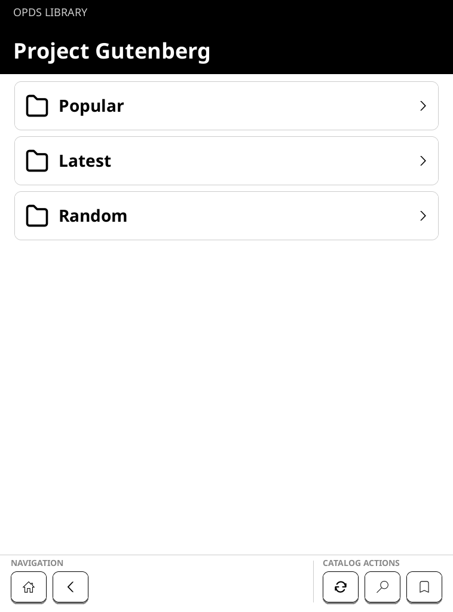

# BokOPDS

BokOPDS lets you browse OPDS catalogs and download books from the standard
home screen on supported Kobo e-readers. It does not install a separate reading
app or replace the built-in library.

[Website](https://bokopds.com/) ·
[Latest release](https://github.com/realcnbs/BokOPDS/releases/latest) ·
[Supported devices](COMPATIBILITY.md)

  

## Before you install

BokOPDS is currently tested on a Kobo Elipsa 2E running firmware
`4.38.23697`. Check [Supported devices](COMPATIBILITY.md) before downloading.
If your exact model and firmware are not marked **Device tested** or
**Community tested**, do not install the release yet.

Installing changes system files on the reader. Back up important books and
settings, charge the reader, and do not disconnect it while an update is being
installed.

## Install

1. Open the [latest release](https://github.com/realcnbs/BokOPDS/releases/latest)
   and download `KoboRoot.tgz`.
2. Connect the reader to your computer and open the `.kobo` folder.
3. **Never overwrite a pending stock update.** If `.kobo/KoboRoot.tgz` already
   exists, eject the reader and let that update finish before continuing.
4. Copy the downloaded `KoboRoot.tgz` into `.kobo`.
5. Safely eject the reader. It will install the update and restart.

On a supported device, **BokOPDS** will appear in the standard home navigation.
The complete guide also explains checksum verification and uninstalling:
[Installation guide](docs/DEVICE_INSTALLATION.md).

## What you can do

- Add OPDS 1 and OPDS 2 catalogs.
- Browse, search, and move between catalog pages.
- Bookmark a catalog page and return to it later.
- Choose preferred book languages.
- Download one book or select several across pages.
- Add completed downloads to the built-in library.
- Use English and Russian keyboard layouts.

Configure Wi-Fi in the standard Kobo interface before opening BokOPDS.

## Need help?

- Check whether your reader is listed in [Supported devices](COMPATIBILITY.md).
- Read the [installation and uninstall guide](docs/DEVICE_INSTALLATION.md).
- [Open an issue](https://github.com/realcnbs/BokOPDS/issues) if something does
  not work. Do not include serial numbers, catalog passwords, or private catalog
  addresses.

## Developers

Build instructions, emulator setup, tests, project structure, and release tools
are in [DEVELOPING.md](DEVELOPING.md).

## License and credits

BokOPDS is community software licensed under `AGPL-3.0-or-later`. It is not
affiliated with or endorsed by Rakuten Kobo, KOReader, or the OPDS
specification maintainers.

See [THIRD_PARTY.md](THIRD_PARTY.md) for the open-source projects included in
BokOPDS and their licenses.
