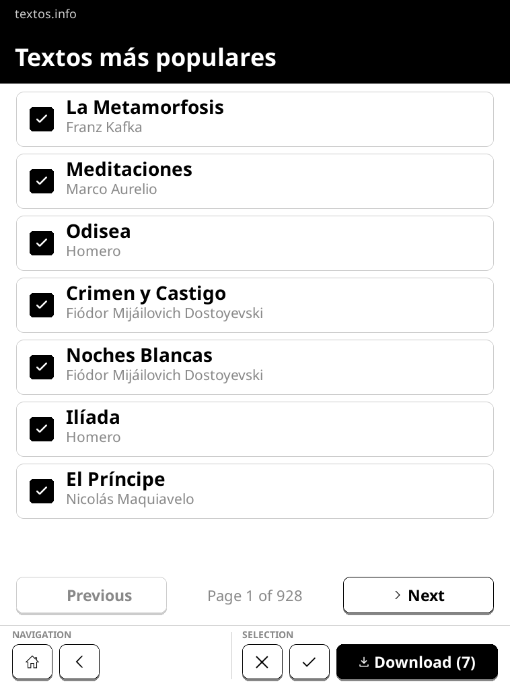

# BokOPDS

BokOPDS is a focused OPDS catalog client for Kobo e-readers. It adds a BokOPDS
item to the stock home navigation and opens directly into catalog browsing.
There is no separate KOReader or NickelMenu installation to manage.

[Project page](https://realcnbs.github.io/BokOPDS/) ·
[Latest release](https://github.com/realcnbs/BokOPDS/releases/latest) ·
[Compatibility table](COMPATIBILITY.md)

The interface is intentionally limited to OPDS: browse and search catalogs,
bookmark catalog locations, filter by preferred publication language, inspect
book metadata, and download one or several books. Completed downloads request
a stock-library rescan.

<p align="center">
  
</p>

The screenshots use live public catalog data rather than fixtures. More views
are available on the [project page](https://realcnbs.github.io/BokOPDS/#screens).

> **Compatibility:** one universal package is used for every allowlisted
> target, but that does not mean every Kobo model is supported. The hook stays
> inert unless the hardware ID and exact firmware match a checked profile.
> See the generated [device compatibility table](COMPATIBILITY.md). The current
> physical-device test covers Kobo Elipsa 2E family ID `389` on `4.38.23697`.

## Highlights

- OPDS 1 Atom and OPDS 2 JSON catalogs
- Catalog search, pagination and full bookmark paths
- Single and multi-book selection across pages
- EPUB, PDF, FB2, MOBI, HTML and text acquisitions
- Unicode-safe `Author - Title.ext` filenames
- Russian and English keyboard layouts through the bundled reader runtime
- E-ink-specific layout, partial input refreshes, autosuspend and USB handling
- Verified HTTPS, hostname checking, origin-bound Basic authentication,
  cancellable requests and bounded feed/cover responses
- Main-library refresh request after downloads

## Install a release archive

Installing a system archive modifies software on the reader. Back up important
books and settings first. Charge the reader and do not interrupt an update.

1. Read [COMPATIBILITY.md](COMPATIBILITY.md) and find the exact model and
   firmware. **Not available** combinations will install inertly and have no
   BokOPDS menu item.
2. Download `KoboRoot.tgz` and `SHA256SUMS` from the same release. Verify the
   checksum with `sha256sum` on Linux, `shasum -a 256` on macOS, or
   `certutil -hashfile KoboRoot.tgz SHA256` on Windows.
3. Connect the reader by USB. Confirm that `.kobo` does not already contain a
   pending `KoboRoot.tgz`; never overwrite a pending stock update.
4. Copy the downloaded `KoboRoot.tgz` into `.kobo`, safely eject, and allow the
   reader to apply the update and restart.

Developers may instead verify, back up, and stage a locally built archive with:

   ```sh
   (cd dist && sha256sum -c SHA256SUMS)
   ./scripts/install-to-reader.sh \
     dist/KoboRoot.tgz /path/to/KOBOeReader
   ```

The developer installer uses the packaged compatibility manifest, refuses an existing pending update,
checks compressed and unpacked space, verifies package layout/ABI, and saves a
private local recovery backup before writing `.kobo/KoboRoot.tgz`.

To uninstall, connect by USB and run:

```sh
./scripts/prepare-uninstall.sh /path/to/KOBOeReader
```

Safely eject and restart. NickelHook processes the uninstall marker and removes
the hook and application directory. Downloaded books are not removed.

More detail is in [device installation](docs/DEVICE_INSTALLATION.md) and
[device testing](docs/DEVICE_TESTING.md).

## Desktop emulator

The emulator tests function and appearance without a physical reader. On
Debian/Ubuntu, install:

```sh
sudo apt-get install curl unzip xz-utils python3 openssl xvfb imagemagick \
  libx11-6 libxext6 libxrender1 libxcb1 libgl1
```

Then run:

```sh
./scripts/run-emulator.sh
./scripts/test-reader-shell-emulator.sh
```

The test suite downloads the pinned desktop runtime, exercises OPDS parsing,
TLS trust and hostname failures, successful and rejected Basic authentication,
credential isolation, authenticated downloads, cancellation, responsive layouts
and screenshot smoke tests. Device behavior which depends on the stock UI still
requires the exact supported reader.

The public catalogs bundled with the pinned KOReader release can also be checked
against their live services:

```sh
./scripts/test-live-catalogs.sh
```

This reports upstream outages and access restrictions separately from feeds
that respond but fail BokOPDS parsing. Set `BOKOPDS_LIVE_STRICT=1` to also treat
an unavailable service as a test failure. Live checks are opt-in so the normal
suite remains deterministic and works offline.

## Build a local device package

Requirements: Docker or Podman, curl, unzip, GNU tar, gzip, `file`, `readelf`,
and the emulator test dependencies.

```sh
git submodule update --init --recursive
./scripts/test-reader-shell-emulator.sh
./scripts/build-release.sh
```

`KoboRoot.tgz`, `SHA256SUMS`, and the compatibility documents are written to
`dist/`. Downloaded runtime archives are pinned by SHA-256 in
`reader-shell/runtime.lock`.

## Architecture

BokOPDS has three active parts:

1. A Lua application shell in `reader-shell/overlay/frontend/apps/bokopds`.
2. A pinned, trimmed KOReader runtime providing mature e-ink rendering,
   keyboard, device/event, networking, suspend and USB infrastructure.
3. A small C++ NickelHook extension in `device-hook` which adds the stock-home
   navigation item and requests a library scan after the app exits. Its
   generated compatibility table selects an exact hardware/firmware profile;
   missing targets or symbols leave the extension inert.

The retired standalone C++ framebuffer application is not part of this source
tree or binary package. See [architecture](docs/ARCHITECTURE.md).

## Third-party code and licenses

BokOPDS uses KOReader and koreader-base for its e-ink runtime, NickelHook for
stock-home integration, Lucide/Feather-derived icons for controls, and Mozilla
CA data for HTTPS. [THIRD_PARTY.md](THIRD_PARTY.md) lists these dependencies,
their versions, licenses and purpose. Source URLs and checksums are pinned in
`reader-shell/runtime.lock`.

The upstream runtime's unlicensed `ffi/__gc.lua` and `lj-wpaclient` files are
explicitly removed. Configure Wi-Fi in the stock Kobo interface before opening
BokOPDS; the app detects and uses the existing connection.

## Project status and license

This is an early community source release with one deliberately narrow tested
device target. It is not affiliated with or endorsed by Rakuten Kobo, KOReader,
or the OPDS specification maintainers.

BokOPDS source is licensed under `AGPL-3.0-or-later`; see [LICENSE](LICENSE).
Third-party components keep their own licenses.
